#  Expense Tracker

A personal finance and shared expense tracking app built with Flutter and Supabase, using Provider and an MVVM architecture.

---

## Features

- **Authentication**: Sign in, sign up, password reset, and OTP recovery via Supabase Auth.
- **Transactions & Filtering**: Log income and expenses with categories, payment methods (UPI or Cash), notes, and custom dates. Search by amount or description, and filter by type, categories, payment method, or date range.
- **Inline Math Input**: Enter arithmetic expressions (`+`, `-`, `*`, `/`) directly in amount fields with a built-in operations bar and live preview.
- **Shared Split Expenses**: Split bills with friends using 6 modes (equal, full debt/credit, exact amounts, percentages, or shares), add custom offline friends, hide/unhide friends, and settle up balances.
- **Analytics & Charts**: Interactive category breakdowns and cash flow charts with customizable date ranges, synchronized with your personal and split expenses.
- **Custom Categories**: Create, edit, delete, and reorder income and expense categories.
- **PDF Statement Export**: Export filtered transaction statements as PDFs to view, share, or save locally.
- **Theming & Preferences**: Light, dark, and system themes, Material 3 dynamic colors on Android, and configurable haptic feedback.

---

## Screenshots

| Screen                 |                                    Light Mode                                     |                                    Dark Mode                                     |
| :--------------------- | :-------------------------------------------------------------------------------: | :------------------------------------------------------------------------------: |
| **Authentication**     |        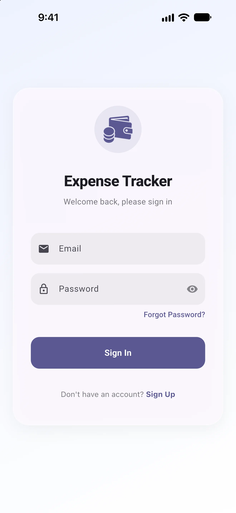        |        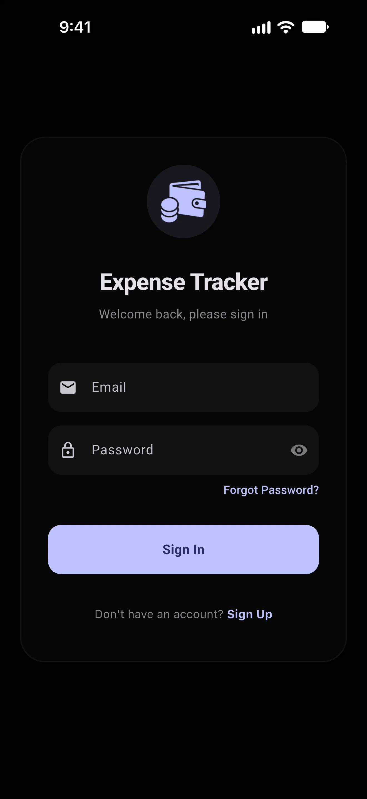        |
| **Transactions**       |    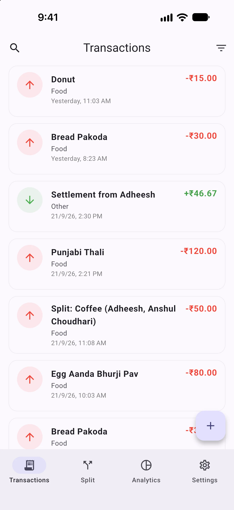    |    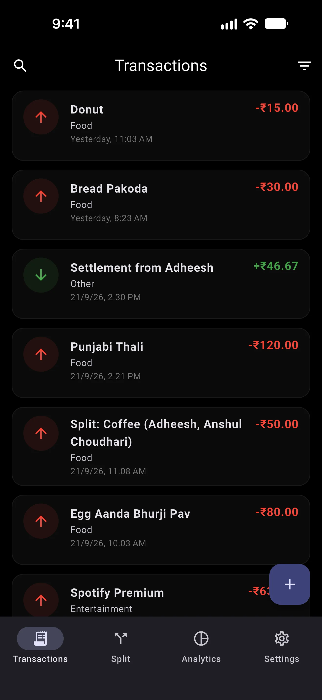    |
| **Add Transaction**    |  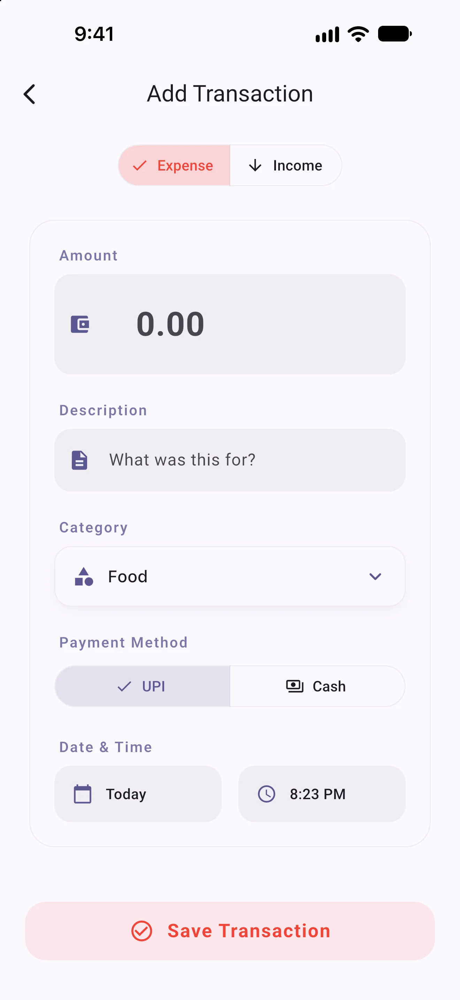   |  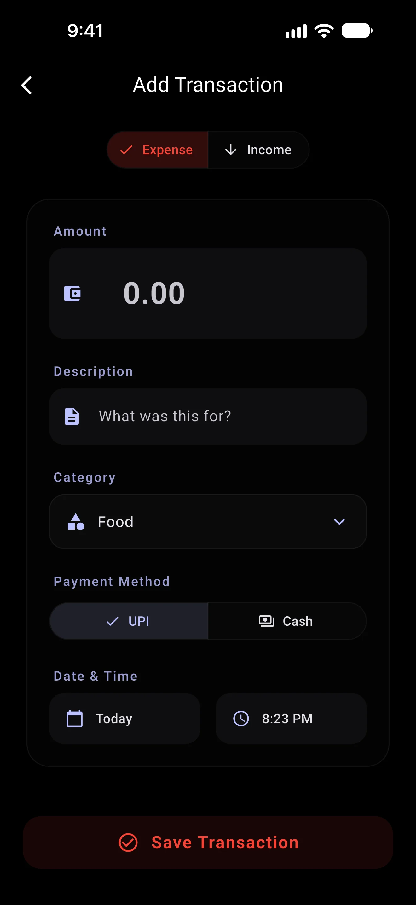   |
| **Split Expenses**     |  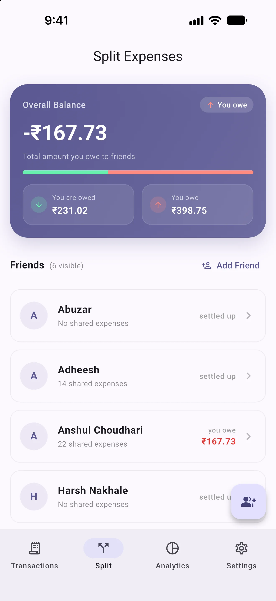   |  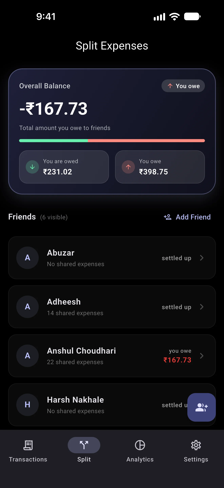   |
| **Add / Edit Split**   |     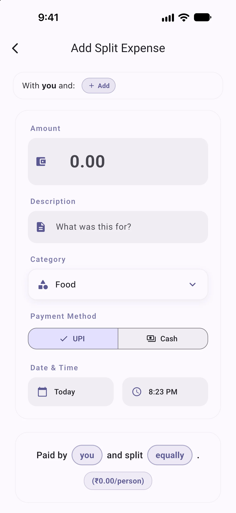      |     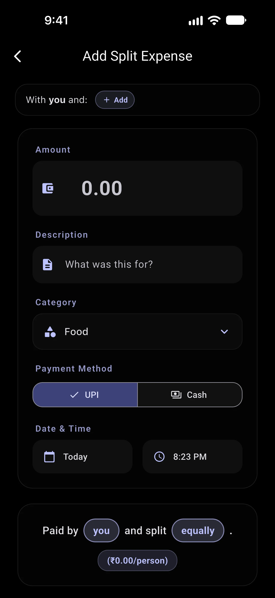      |
| **Analytics Overview** |     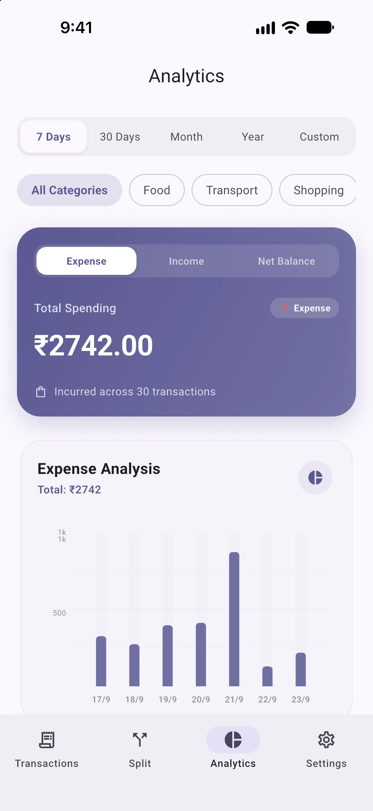      |     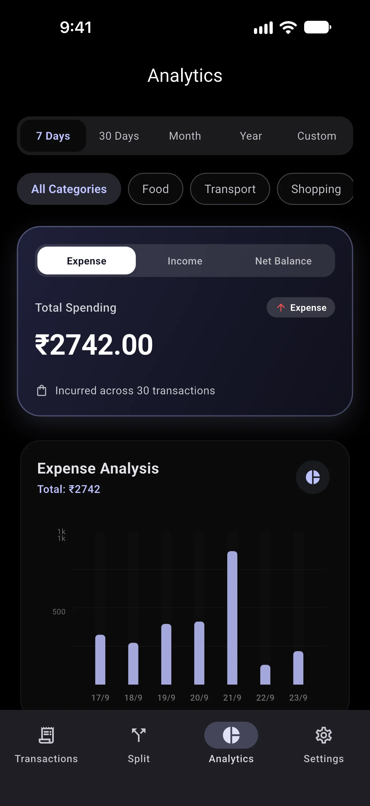      |
| **Category Breakdown** | 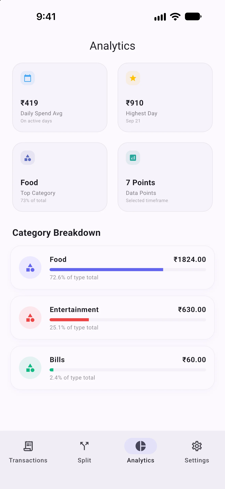 | 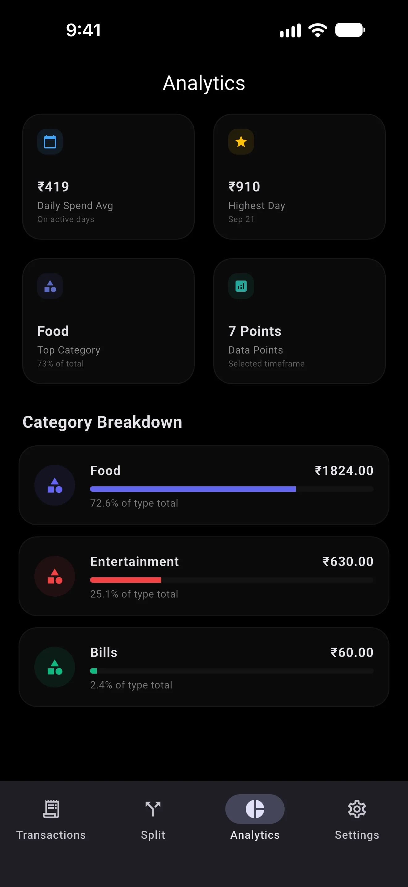 |
| **Settings**           |      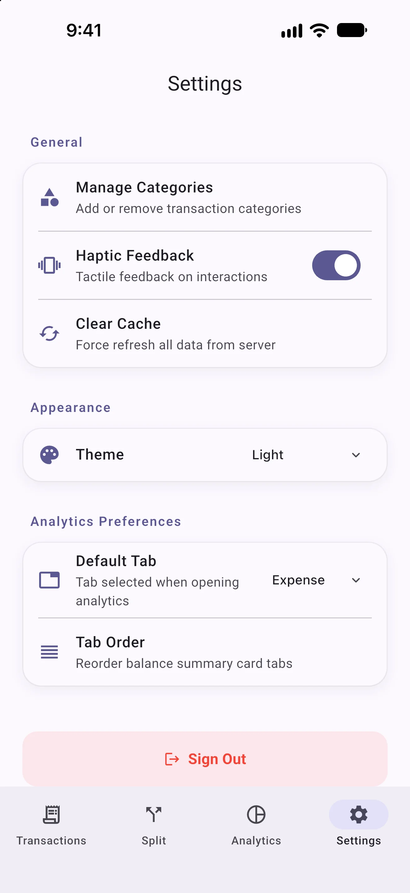      |      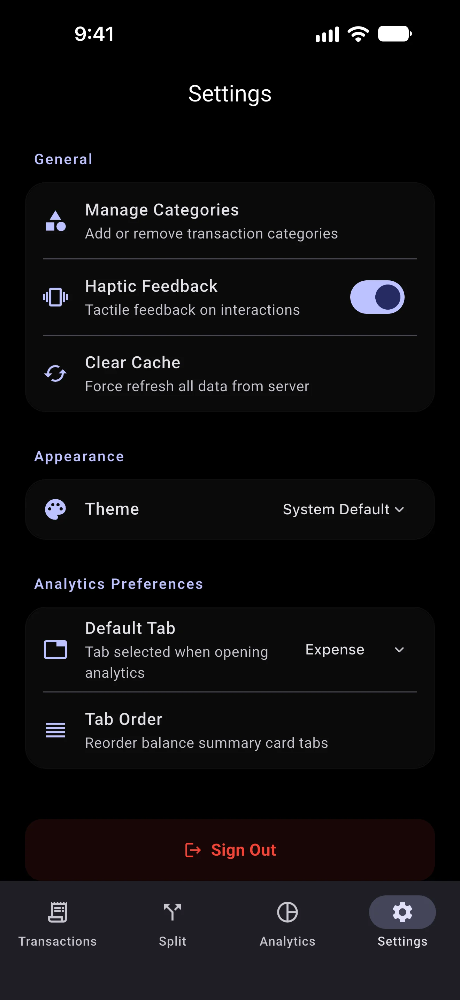      |
| **Manage Categories**  | 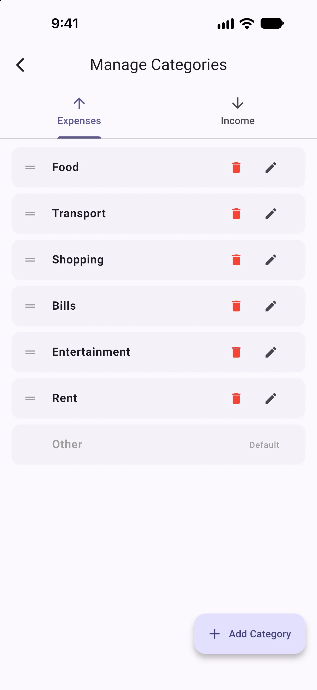  | 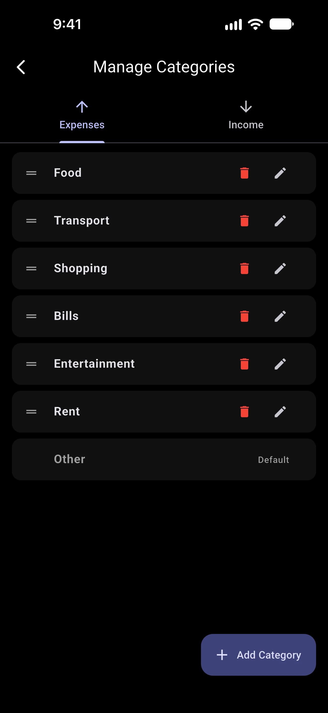  |

---

## Tech Stack

- **Framework**: Flutter (Dart)
- **Backend & Auth**: Supabase (`supabase_flutter`)
- **State Management**: Provider (MVVM + Service architecture)
- **Charts**: `fl_chart`
- **PDF Export**: `pdf`, `open_file`, `share_plus`
- **Local Preferences**: `shared_preferences`

---

## Project Structure

```text
lib/
├── app/         # App configuration, theme setup, and Provider bindings
├── models/      # Domain data models
├── services/    # Supabase auth, database, and PDF export services
├── viewmodels/  # State management and business logic
├── views/       # UI screens and page-specific widgets
├── widgets/     # Reusable UI components
└── utils/       # Formatting, math evaluation, haptics, and exceptions
```

---

## Getting Started

### Prerequisites

- [Flutter SDK](https://flutter.dev/docs/get-started/install) (`>= 3.47.0`, Dart `>= 3.13.0`)
- A configured [Supabase](https://supabase.com) project
- An Android/iOS emulator or physical device

### Setup

1. Clone the repository:

   ```bash
   git clone <repository_url>
   cd expense_tracker
   ```

2. Install dependencies:

   ```bash
   flutter pub get
   ```

3. Run the app with your Supabase credentials:
   ```bash
   flutter run \
     --dart-define=SUPABASE_URL=https://your-project.supabase.co \
     --dart-define=SUPABASE_ANON_KEY=your-anon-key
   ```
   Or using a `.env.json` file:
   ```bash
   flutter run --dart-define-from-file=.env.json
   ```

---

## License

This project is licensed under the MIT License - see the [LICENSE](LICENSE) file for details.
